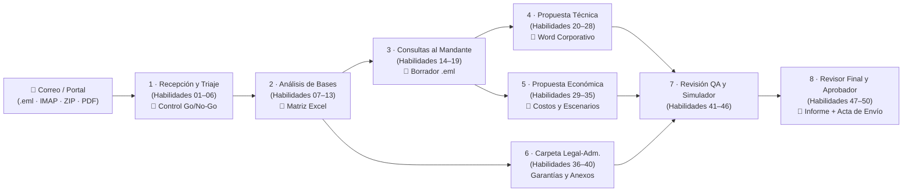

# ⚡ BidFactory AI — Sistema Multi-Agente de Licitaciones e Ingeniería de Propuestas (B2B)

> **De la recepción del correo de invitación al envío aprobado en una fracción del tiempo.**  
> *Arquitectura de 8 Agentes Especializados · 50 Habilidades Preconfiguradas · Automatización Nativa Outlook/Gmail (`.eml` / IMAP), Excel (`.xlsx`) y Word (`.docx`) · Aplicación de Escritorio Windows (`.exe`) con Control Humano Ejecutivo (Human-in-the-Loop).*

---

## 1. El Problema en Empresas de Ingeniería, Consultoría, Minería, Construcción y Energía

En empresas B2B técnicas, preparar una licitación pública o privada (Mercado Público, SAP Ariba, Coupa o invitaciones directas por correo) consume entre **30 y 120 horas de ingenieros senior** por oferta:

1. **Pérdida de oportunidades por triaje tardío:** Correos de invitación o aclaraciones que no se transforman a tiempo en un calendario regresivo ni en una evaluación objetiva *Go / No-Go*.
2. **Descalificaciones por forma (Inadmisibilidad):** Un anexo administrativo omitido, una glosa de boleta de garantía mal redactada, un requisito escondido en la página 84 de los Términos de Referencia (TdR) o un precio filtrado por error en el sobre técnico.
3. **Inconsistencia entre la Oferta Técnica y la Económica:** Lo que promete la metodología o la Carta Gantt no calza con las Horas Hombre (HH) ni con los costos directos de terreno/laboratorio en la planilla económica.
4. **Cuello de botella en el Socio / Gerente Técnico (Revisor Final y Aprobador):** Quien firma la oferta debe revisar a última hora documentos extensos sin un tablero ejecutivo de riesgos, márgenes y cumplimiento.

---

## 2. La Solución: BidFactory AI (Fábrica de Licitaciones)

**BidFactory AI** es una plataforma local y auditable que organiza un **Departamento Completo de Licitaciones asistido por IA** compuesto por **8 roles especializados** y **50 habilidades operativas (`SKILL.md`)** conectadas a un motor de automatización documental en Python y una consola de escritorio nativa para Windows.



---

## 3. Arquitectura de los 8 Roles del Equipo

| # | Rol en el Sistema | Función Operativa | Entregable Principal que Genera |
|---:|---|---|---|
| **01** | **Bid Manager (Orquestador)** | Crea la estructura del proceso, calcula el calendario regresivo de hitos internos y actualiza la cartera general. | `ficha.json`, `estado.json`, `cartera_licitaciones.xlsx` |
| **02** | **Analista de Bases** | Descomprime antecedentes (`.zip`, `.pdf`, `.docx`, `.xlsx`), detecta anexos faltantes y extrae cada requisito administrativo, técnico y criterio de evaluación. | `matriz_cumplimiento.xlsx` (con fórmulas y semáforo) + `preguntas_ronda_1.md` |
| **03** | **Especialista Técnico** | Redacta la comprensión del problema, la metodología paso a paso alineada 1:1 con los TdR, la Carta Gantt, el equipo propuesto, el Plan HSE/SSOMA y el Plan QA/QC usando las plantillas históricas de la empresa. | `propuesta_tecnica_<CODIGO>.docx` |
| **04** | **Estimador de Costos** | Construye la EDT, calcula las HH por rol, costea terreno/laboratorio/subcontratos y modela 3 escenarios de precio (*Agresivo*, *Objetivo*, *Conservador*). | `costos.xlsx` (3 pestañas vinculadas con fórmulas) |
| **05** | **Administrativo-Legal** | Controla anexos obligatorios, declaraciones juradas, vigencia de certificados (F30, registros de proveedores), glosa exacta de garantías y riesgos contractuales. | `checklist.md`, `riesgos_contractuales.md` |
| **06** | **Revisor QA (Control de Calidad)** | Verifica el 100% de la Matriz de Cumplimiento, ejecuta el **Evaluador Simulado** (puntúa la oferta con la pauta del mandante) y audita que no existan textos pendientes ni precios filtrados en el sobre técnico. | `verificacion_estilo_y_formato.md` |
| **07** | **Revisor Final (Humano en el Loop)** | Recibe un informe ejecutivo en Word de 5 minutos con el % de cumplimiento, causales de inadmisibilidad, puntaje técnico simulado y riesgos abiertos. | `informe_revisor_final.docx` |
| **08** | **Aprobador Ejecutivo (Humano en el Loop)** | Define el precio definitivo a ofertar entre los escenarios calculados y emite el Acta de Aprobación que habilita la carga o envío de la oferta. | `acta_aprobacion.md` |

---

## 4. Las 50 Habilidades Preconfiguradas (8 Fases)

### Fase I · Recepción y Triaje (Habilidades 01–06)
- `01` Lectura automática del correo de invitación (`.eml` o bandeja Gmail/IMAP)
- `02` Descarga, descompresión (`.zip`) y ordenamiento de bases y anexos + alerta de documentos faltantes
- `03` Ficha resumen ejecutiva de la licitación (`ficha.json`)
- `04` Calendario de hitos externos e internos regresivos
- `05` Registro en el tablero de Cartera General (`cartera_licitaciones.xlsx`)
- `06` **Matriz ponderada de decisión Go / No-Go** *(🔴 Punto de Control Humano 1)*

### Fase II · Análisis Profundo de Bases (Habilidades 07–13)
- `07` Extracción trazable de requisitos administrativos (BAG / BAE)
- `08` Extracción trazable de requisitos técnicos y normas (TdR)
- `09` Generación de la **Matriz de Cumplimiento en Excel** (`matriz_cumplimiento.xlsx`)
- `10` Desglose de criterios de evaluación, fórmulas de puntaje y estrategia ganadora
- `11` Ficha de boletas de garantía y pólizas de seguro exigidas
- `12` Auditoría de riesgos contractuales (multas, retenciones, responsabilidad, *Differing Site Conditions*)
- `13` Cruce de requisitos de experiencia de la empresa y perfiles mínimos del equipo

### Fase III · Consultas, Aclaraciones y Adendas (Habilidades 14–19)
- `14` Detección de ambigüedades técnicas, vacíos de información y contradicciones en las bases
- `15` Redacción estratégica de preguntas al mandante (sin revelar ventajas competitivas a otros oferentes)
- `16` Generación de borrador `.eml` de consultas listo para revisión y envío *(🔴 Punto de Control Humano 2)*
- `17` Procesamiento de serie de respuestas y aclaraciones oficiales del mandante
- `18` Control de adendas y modificaciones de calendario o alcance
- `19` Actualización automática de la Matriz de Cumplimiento tras aclaraciones

### Fase IV · Elaboración de la Propuesta Técnica (Habilidades 20–28)
- `20` Comprensión del problema y diagnóstico técnico del emplazamiento
- `21` Desarrollo de metodología por etapa (numeración espejo 1:1 con los TdR del cliente)
- `22` Plan de trabajo, secuencia constructiva y **Carta Gantt**
- `23` Organigrama, matriz de responsabilidades y asignación de equipo clave
- `24` Adaptación curricular (CVs) al formato exigido por el mandante
- `25` Selección y respaldo de experiencia verificada (*Track Record* acreditable)
- `26` Plan de Seguridad, Salud Ocupacional y Medio Ambiente (HSE / SSOMA)
- `27` Plan de Aseguramiento y Control de Calidad (QA/QC) y matriz de entregables
- `28` Integración de mapas, figuras técnicas y anexos metodológicos

### Fase V · Elaboración de la Propuesta Económica (Habilidades 29–35)
- `29` Estructura de Desglose de Trabajo (EDT) alineada al formulario oficial
- `30` Estimación de Horas Hombre (HH) por perfil y etapa (`HH_Profesionales`)
- `31` Costeo de gastos directos operacionales: terreno, camionetas, viáticos, laboratorio, sondajes y subcontratos (`Costos_Directos`)
- `32` Cálculo de Gastos Generales (GG), contingencia por riesgo y utilidad
- `33` Cuadratura del Formulario Económico oficial del mandante
- `34` **Modelación de 3 Escenarios de Precio y Sensibilidad** (*Agresivo*, *Objetivo*, *Conservador*) *(🔴 Punto de Control Humano 3)*
- `35` Auditoría cruzada de coherencia Técnico-Económica (metodología vs. Gantt vs. HH vs. costos)

### Fase VI · Documentación Legal y Administrativa (Habilidades 36–40)
- `36` Checklist de sobre administrativo (`checklist.md`)
- `37` Preparación de declaraciones juradas societarias y de cumplimiento (Ley 20.393, conflicto de interés)
- `38` Verificación letra por letra de la Garantía de Seriedad de la Oferta
- `39` Control de vigencia de certificados (Vigencia societaria, F30, ChileProveedores, SICEP, REGIC, Mutualidad)
- `40` Control de firmas, foliado y separación estricta de sobres

### Fase VII · Revisión QA y Simulación de Evaluación (Habilidades 41–46)
- `41` Verificación 100% contra Matriz de Cumplimiento (bloqueo ante cualquier causal de inadmisibilidad pendiente)
- `42` Revisión Técnica Par (*Peer Review*)
- `43` Revisión aritmética y financiera de la oferta económica
- `44` Revisión legal de desviaciones declaradas y supuestos operacionales
- `45` **Evaluador Simulado:** calificación de la oferta bajo la pauta del mandante antes de enviarla
- `46` Verificador automático de estilo, formato Word corporativo y no-filtración de precios (`--verificar`)

### Fase VIII · Revisión Final, Aprobación de Envío y Post-Licitación (Habilidades 47–50)
- `47` **Emisión del Informe Ejecutivo en Word para el Revisor Final** (`informe_revisor_final.docx`) *(🔴 Punto de Control Humano 4)*
- `48` **Firma del Acta de Aprobación de Envío y fijación del precio definitivo** (`acta_aprobacion.md`) *(🔴 Punto de Control Humano 5)*
- `49` Empaquetado final, carga en portal / despacho con margen de seguridad y archivo de comprobante
- `50` Seguimiento de apertura/adjudicación, análisis de precios de la competencia y retroalimentación de la Base de Conocimiento

---

## 5. Arquitectura de Datos, Seguridad y Modalidades de IA (Transparencia Técnica B2B)

BidFactory AI separa claramente el **Motor Documental y Financiero (100% Local en el PC/Servidor del cliente)** de la **Capa de Razonamiento Lingüístico (LLM)**, permitiendo a cada empresa elegir el nivel de privacidad que exigen sus contratos de confidencialidad (NDA):

### 5.1 ¿Qué corre 100% en el equipo local del cliente (sin enviar datos a la nube)?
- **Almacenamiento de Archivos y Costos:** Todas las carpetas de `licitaciones/`, las tarifas horarias (`tarifas.md`), las planillas financieras (`costos.xlsx`), la `cartera_licitaciones.xlsx` y los documentos Word finales residen físicamente en el disco o servidor interno de la empresa compradora (no en una nube SaaS de terceros).
- **Motores Matemáticos y Compiladores Python (`.exe`):** La lectura de archivos `.eml`, la descompresión de `.zip`, la extracción de texto de PDFs (`PyMuPDF`), el cálculo de escenarios y márgenes en Excel (`openpyxl`), la compilación de tablas y estilos en Word (`python-docx`) y la auditoría de formato (`--verificar`) se ejecutan **100% en la CPU local**.

### 5.2 ¿Cuándo interviene el LLM y qué opciones tiene la empresa compradora?
Cuando los Agentes IA ejecutan tareas cognitivas sobre una licitación nueva (por ejemplo: leer e interpretar un Término de Referencia de 120 páginas, redactar la metodología técnica a medida o simular al evaluador del mandante), el texto de trabajo es procesado por un Modelo de Lenguaje (LLM) bajo **3 modalidades configurables según la política de ciberseguridad del cliente**:

| Modalidad de IA | Cómo funciona | Nivel de Privacidad / Uso Recomendado |
|---|---|---|
| **Opción A · Cloud LLM Empresarial (Estándar Recomendado)** | Conecta las 50 habilidades a modelos de frontera en la nube (**Google Gemini Pro / Vertex AI, Anthropic Claude Sonnet/Opus o Azure OpenAI**) mediante API comercial o entorno agéntico (Antigravity / Claude Code). | **Alto (Zero-Data-Retention por API):** Los proveedores empresariales no entrenan modelos con datos enviados por API comercial. Entrega la máxima calidad de redacción en ingeniería, geotecnia y contratos. |
| **Opción B · Modo Híbrido con Sanitización de Precios** | El LLM en la nube solo recibe los documentos técnicos públicos de las bases (TdR) para redactar la propuesta técnica y la matriz, mientras que **los costos, tarifas UF/HH, márgenes y el precio final (`costos.xlsx` e `informe_aprobacion.py`) se calculan exclusivamente en local** sin pasar jamás por el LLM. | **Muy Alto:** Ideal para consultoras y constructoras que quieren la potencia de Claude/Gemini en la parte técnica pero manteniendo su estructura de costos 100% fuera de la nube. |
| **Opción C · LLM 100% Local / Air-Gapped (On-Premise GPU)** | Conecta el sistema a un servidor local de la propia empresa corriendo **Ollama / vLLM** (con modelos abiertos como *Qwen 2.5 72B* o *Llama 3.3 70B*). | **Aislamiento Total (Offline):** Ningún byte sale a internet. Diseñado para contratos mineros o de infraestructura crítica con cláusulas de reserva estricta. |

---

## 6. Diferenciadores Comerciales Clave (Por qué las empresas compran BidFactory AI)

1. **Política de "Cero Datos Inventados" (*Anti-Hallucination Guardrails*):**
   - El sistema se alimenta exclusivamente de la carpeta `base_conocimiento/` de la empresa compradora (su propio *track record* verificado, sus tarifas UF/USD/CLP reales y sus CVs). Si un dato no existe, inserta un marcador auditable `[COMPLETAR]` que el verificador QA detecta antes de emitir el documento.
2. **Estandarización con el Formato Propio de cada Cliente (`plantillas/modelos_propuesta/`):**
   - Cada empresa cliente deposita su propio archivo Word con membrete (`plantilla_base_geologgia.docx`) y sus propuestas históricas exitosas, logrando que todas las ofertas salgan con su identidad visual corporativa exacta.
3. **Doble Interfaz Incluida:**
   - **Aplicación de Escritorio Windows (`Geologgia_Fabrica_Licitaciones.exe`):** Con icono en el Escritorio para importar correos `.eml`, adjuntar carpetas de bases (`.pdf`, `.docx`, `.zip`), abrir entregables Excel/Word y aprobar el envío en 1 clic.
   - **Panel Web Interactivo (`panel_equipo_licitaciones.html`):** Mapa visual estilo IDE de las 50 habilidades y consola de cartera en vivo.

---

## 6. Requisitos Técnicos e Instalación para Nuevos Clientes

- **Sistema Operativo:** Windows 10 / 11 (64 bits), macOS o Linux.
- **Stack Tecnológico:** Python 3.11+ (`openpyxl`, `python-docx`, `PyMuPDF`, `Pillow`, `tkinter`). Incluye compilación opcional a ejecutable autónomo `.exe` vía `PyInstaller`.
- **Tiempo de Puesta en Marcha (*Onboarding* para una nueva empresa):** **Menos de 2 horas**, completando únicamente 4 archivos en `base_conocimiento/`:
  1. `empresa.md` (Razón social, RUT, representante legal, registros de proveedores).
  2. `experiencia_geologgia.md` (Listado de proyectos reales ejecutados por la empresa).
  3. `equipo.md` (Nómina de profesionales clave y años de experiencia).
  4. `tarifas.md` (Tarifas horarias por rol, costos de terreno y márgenes objetivo).

---

## 7. Estructura del Producto Entregado

```text
equipo_licitaciones/
├── Geologgia - Fábrica de Licitaciones (Acceso directo de Escritorio .lnk)
├── fabrica_licitaciones_app.py             # Aplicación gráfica de escritorio (GUI oscura)
├── panel_equipo_licitaciones.html          # Mapa interactivo web de las 50 habilidades + Cartera
├── infografia_equipo_licitaciones.png      # Póster visual de alta resolución (1600x1920 px)
├── cartera_licitaciones.xlsx               # Tablero general de todas las licitaciones
├── 00-bid-manager/SKILL.md                 # Orquestador maestro y reglas de negocio
├── habilidades/                            # Las 50 habilidades (habilidad-01.md a habilidad-50.md)
├── base_conocimiento/                      # Datos reales de la empresa, experiencia, equipo y tarifas
├── plantillas/
│   └── modelos_propuesta/                  # Biblioteca de formatos Word e informes tipo del cliente
├── scripts/                                # 9 motores Python (Correo, PDF/ZIP, Excel, Word, QA)
└── licitaciones/                           # Carpetas individuales por cada licitación procesada
```
